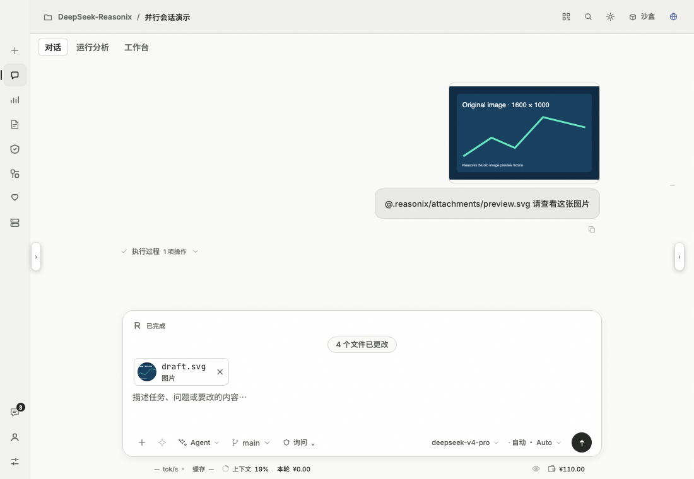
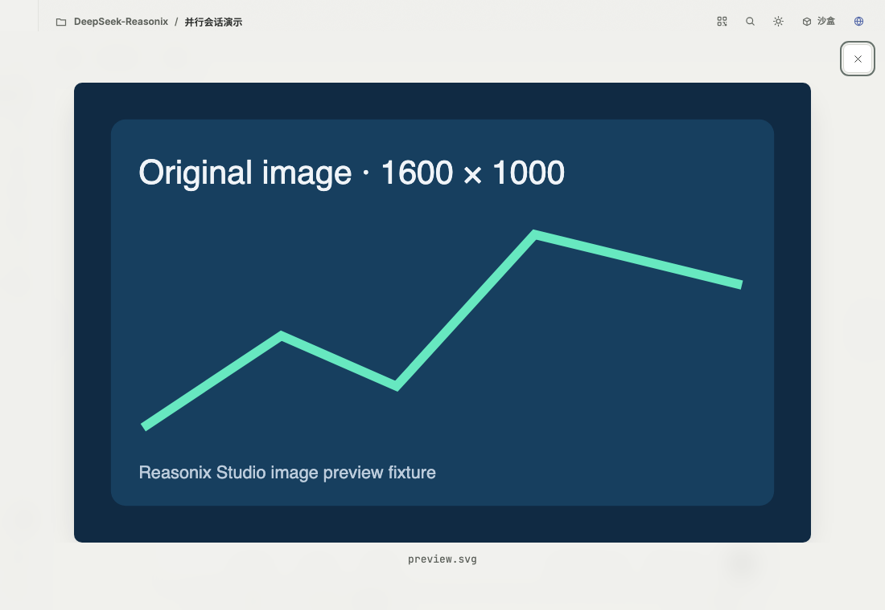
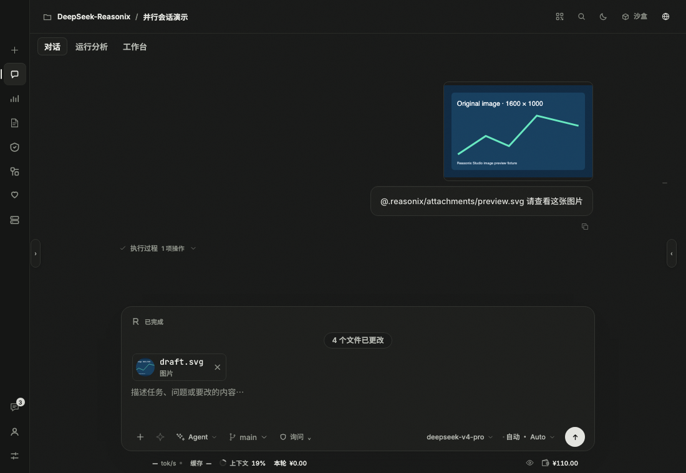
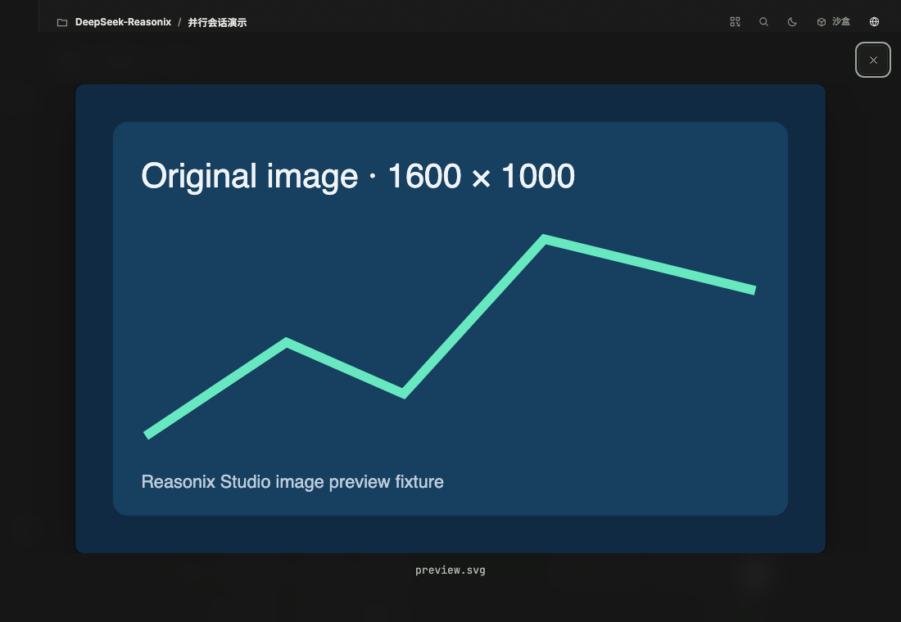
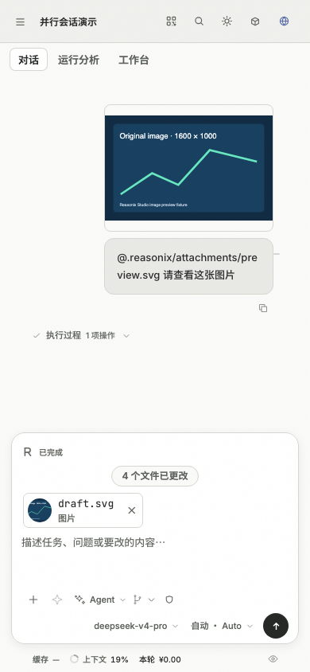
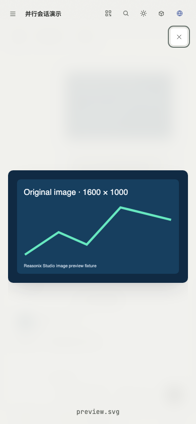
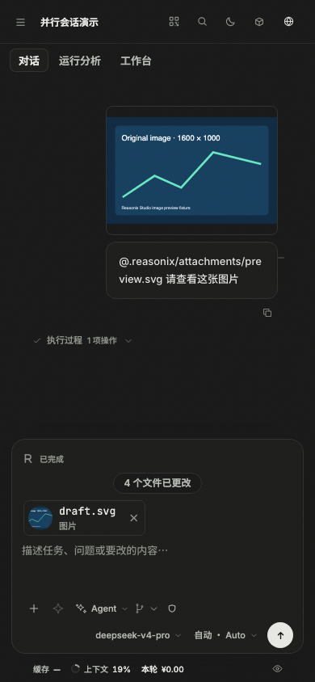
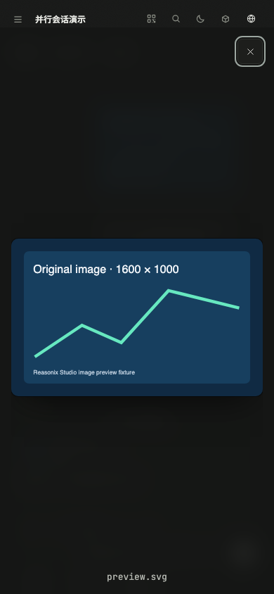

# Studio image preview / Studio 图片预览

Click a saved image in a user message, an uploaded or pasted image in the
composer, or a tool screenshot to open the same original-image viewer. Keyboard
users can focus the thumbnail and press Enter or Space. Double clicking also
opens the viewer without dismissing it on the second click.

点击用户消息中的已保存图片、输入框中上传或粘贴的图片，或工具截图，即可打开同一个
原图查看器。也可以聚焦缩略图后按 Enter 或空格；双击时第二次点击不会误关闭预览。

The viewer uses the existing image source and fits it to the available window
without changing the stored image. Escape, the close button, or the background
closes it and returns focus to the thumbnail. Closing a preview keeps the draft
and attachment.

Removing the attachment or changing the message's runtime image source closes
the preview. An unavailable image keeps a visible error and a working close
button. This viewer does not add zoom or a 1:1 size mode.

查看器使用现有图片源，按窗口大小适配显示，不修改保存的图片。Esc、关闭按钮或点击背景
可关闭预览，并将焦点交还缩略图。关闭预览会保留草稿和附件；移除附件或切换消息的运行时
图片源会关闭预览。图片不可用时显示错误，关闭按钮仍可使用。本查看器不提供缩放或 1:1
原尺寸模式。

## Visual verification / 视觉验证

The before images use Studio `ffd136f463524e1ff275a4f1407dc053073c34ce`.
Both sets show the same 1600 × 1000 fixture after double clicking its user-message
thumbnail. The browser guard also exercises composer and tool entrances, focus,
closing, aspect ratio, and 150% interface zoom.

修改前截图来自 Studio `ffd136f463524e1ff275a4f1407dc053073c34ce`。两组截图均在双击
同一张 1600 × 1000 测试图片后拍摄。浏览器回归还覆盖输入框和工具入口、焦点、关闭、
宽高比及 150% 界面缩放。

| Theme and width / 主题与宽度 | Before / 修改前 | After / 修改后 |
| --- | --- | --- |
| Light / 浅色 · 1100px |  |  |
| Dark / 深色 · 1100px |  |  |
| Light / 浅色 · 390px |  |  |
| Dark / 深色 · 390px |  |  |

Run `node perf/image-preview.mjs` against the built performance harness; set
`PERF_URL` to its served `perf.html` address. CI runs this guard in the Studio
browser checks. Set `IMAGE_PREVIEW_SHOTS` to capture verification images.

对构建后的性能测试页面运行 `node perf/image-preview.mjs`，通过 `PERF_URL` 指定其
`perf.html` 地址。CI 在 Studio 浏览器检查中运行此回归；设置 `IMAGE_PREVIEW_SHOTS`
可保存验证截图。
